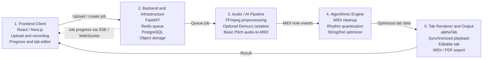

# AI Guitar-to-Tab Transcription App
## Project specification and implementation guide

**Document purpose:** This file is the source of truth for an AI coding assistant or VS Code extension working on this repository. Read it before making changes. Use it to understand the product, architecture, technical decisions, scope, milestones, and acceptance criteria.

**Project status:** Planning / early implementation  
**Initial target:** A local-first MVP that converts a short, single-guitar recording into editable, reasonably playable guitar tablature.

---

# 1. Product overview

Build an application that accepts a guitar audio recording or microphone recording and produces guitar tablature.

The intended user flow is:

1. A user uploads or records a short guitar performance.
2. The backend validates and preprocesses the audio.
3. An audio-to-MIDI model detects musical notes.
4. A custom algorithm maps detected pitches to guitar strings and frets.
5. The frontend displays editable tablature with synchronized playback.
6. The user can export the result.

The project should demonstrate meaningful software engineering, audio/ML integration, algorithm design, testing, and product-quality implementation. Do not build only a thin interface around pretrained models. The custom guitar string/fret optimizer is a major differentiator.

## MVP scope

| Area | Initial scope |
|---|---|
| Instrument | One guitar at a time |
| Input | Uploaded audio; microphone recording can follow |
| Recording | Short clips, initially about 15–60 seconds |
| Guitar sound | Start with clean or relatively isolated guitar |
| Tuning | Standard E A D G B E |
| Notes | Single-note melodies first; simple chords after |
| Fretboard | 6 strings, frets 0–24 initially |
| Output | Editable guitar tablature |
| Playback | Audio playback synchronized with tab where practical |
| Export | MIDI and PDF; add Guitar Pro-compatible export after validating format support |

## Explicitly out of scope for the first MVP

Do not attempt these until the core pipeline works:

- Full-band transcription as a guaranteed feature.
- Multiple simultaneous guitar tracks.
- Reliable transcription of heavily distorted or noisy guitar.
- Alternate tunings and automatic tuning detection.
- Capo detection.
- Advanced expressive techniques such as bends, slides, hammer-ons, pull-offs, and vibrato.
- YouTube URL ingestion.
- Social features, subscriptions, or a complex user account system.

YouTube ingestion should be considered only after the upload workflow works and the implementation complies with platform terms and copyright requirements.

---

# 2. High-level system architecture

The system has five logical layers.



## 2.1 Frontend

**Recommended technology:** React with Next.js and TypeScript.

Responsibilities:

- Upload an audio file.
- Preview and play the uploaded recording.
- Optionally record audio through the browser microphone.
- Select tuning and basic transcription settings.
- Submit a transcription job.
- Display job progress and errors.
- Display tablature.
- Allow users to correct notes and string/fret positions.
- Play audio alongside the tab.
- Offer supported exports.

The frontend must not perform model inference or long-running transcription.

## 2.2 Backend and infrastructure

**Recommended technology:** FastAPI with Python.

Responsibilities:

- Validate requests and uploaded files.
- Create and track transcription jobs.
- Store uploaded and generated files.
- Enqueue background processing.
- Report job status and progress.
- Return transcription results.
- Persist job metadata and user edits.

Suggested infrastructure:

| Component | Initial / later use |
|---|---|
| FastAPI | HTTP API and application services |
| Redis | Background queue broker and temporary state |
| Celery or RQ | Background job execution |
| PostgreSQL | Job metadata, settings, and saved edits |
| S3-compatible object storage | Uploaded audio and generated artifacts |
| SSE or WebSockets | Live job progress |

**Implementation rule:** Begin locally with the simplest working setup. Add Redis, PostgreSQL, and cloud storage when the local audio pipeline is proven. Do not introduce AWS infrastructure before it is useful.

## 2.3 Audio and AI pipeline

Recommended processing stages:

1. Validate the uploaded audio.
2. Convert audio to a supported format using FFmpeg.
3. Normalize sample rate and channel layout as required by the selected model.
4. Optionally isolate guitar with Demucs when the input contains other instruments.
5. Run Basic Pitch to estimate note events and create MIDI.
6. Post-process MIDI events.

Important model notes:

- Basic Pitch is a polyphonic audio-to-MIDI transcription model, not a guitar-specific tablature model.
- It works best when the input contains one instrument at a time.
- It estimates musical pitches and note events; it does not determine guitar string/fret positions.
- Demucs guitar isolation requires a model that actually provides a guitar stem. Do not assume every Demucs model produces one.
- Make stem isolation optional. If the user uploads an already-isolated guitar recording, skip it.
- Confirm current library APIs and model requirements from their official documentation when implementing. Do not rely on assumed function signatures.

## 2.4 Algorithmic engine

This is the primary custom engineering component.

Responsibilities:

- Parse MIDI into note events.
- Filter unreliable or duplicate events.
- Refine note onsets and offsets where possible.
- Quantize rhythm conservatively.
- Group simultaneous notes into chords.
- Generate candidate string/fret positions.
- Select a globally playable sequence or set of chord shapes.

The optimizer should not assign every note independently. The same pitch can be played in multiple places on the fretboard. The algorithm should consider the surrounding notes and choose positions that make the passage playable.

## 2.5 Tab rendering and output

**Recommended renderer:** alphaTab.

Responsibilities:

- Convert optimized note/string/fret data into a supported score representation.
- Render tablature.
- Support user corrections.
- Synchronize the displayed tab with audio playback where supported.
- Export PDF and MIDI initially.
- Investigate Guitar Pro-compatible export after validating alphaTab's current format capabilities.

Do not claim an export format is supported until it has been tested end to end.

---

# 3. Guitar fretboard model

Start with standard tuning and six strings.

| String number | Name | Open-string MIDI pitch |
|---:|---|---:|
| 6 | E2 (low E) | 40 |
| 5 | A2 | 45 |
| 4 | D3 | 50 |
| 3 | G3 | 55 |
| 2 | B3 | 59 |
| 1 | E4 (high E) | 64 |

For a MIDI pitch and a candidate string:

```text
fret = midi_pitch - open_string_midi_pitch
```

A candidate is valid when:

```text
0 <= fret <= maximum_fret
```

Use 24 as the initial maximum fret, but make the fret count configurable.

A pitch may have multiple valid string/fret positions. The optimizer chooses among them.

## 3.1 Candidate generation

For every note event:

1. Read its MIDI pitch.
2. Iterate through all six strings.
3. Calculate the fret for each string.
4. Keep candidates within the valid fret range.
5. Store string, fret, pitch, and any relevant note metadata.

## 3.2 Optimization objectives

Start with a transparent cost function. Possible penalties include:

- Fret movement between consecutive notes.
- Large position shifts.
- Excessive stretches.
- Unnecessary string changes.
- Awkward transitions between hand positions.
- Chord shapes that cannot reasonably be fingered.

Do not overcomplicate the first version. Implement a baseline dynamic programming solution for monophonic note sequences, test it, then improve it.

For simultaneous notes, validate that all notes can be assigned to distinct playable string positions. Add chord-specific constraints after the monophonic version is reliable.

## 3.3 Optimizer test cases

Create deterministic tests for:

- Open-string notes.
- Notes with exactly one valid position.
- Notes with multiple valid positions.
- Notes outside the supported fretboard range.
- Ascending and descending melodies.
- Repeated notes.
- Large pitch jumps.
- Simultaneous notes / simple chords.
- Empty MIDI input.
- Invalid or malformed note events.

Tests should verify both validity and expected optimization behavior.

---

# 4. Job processing and API design

Long-running audio inference must run in a background worker.

## 4.1 Job lifecycle

```text
PENDING
  -> PREPROCESSING
  -> SEPARATING (optional)
  -> TRANSCRIBING
  -> POST_PROCESSING
  -> OPTIMIZING_TAB
  -> COMPLETED

Any active stage -> FAILED
```

Persist at least:

- Job ID.
- Current status and stage.
- Progress percentage, if available.
- Creation and update timestamps.
- Input file reference.
- Output artifact references.
- Error code and safe user-facing error message.
- Relevant processing configuration.

Do not expose stack traces, secrets, or internal filesystem paths to the frontend.

## 4.2 Suggested API endpoints

These are initial design suggestions. Adjust them if implementation reveals a better contract, and document changes.

| Method | Endpoint | Purpose |
|---|---|---|
| POST | `/api/transcriptions` | Upload audio and create a job |
| GET | `/api/transcriptions/{id}` | Get job metadata |
| GET | `/api/transcriptions/{id}/status` | Get current stage and progress |
| GET | `/api/transcriptions/{id}/result` | Retrieve completed tab and artifact references |
| PATCH | `/api/transcriptions/{id}/tab` | Save user corrections |
| DELETE | `/api/transcriptions/{id}` | Delete a job and its associated artifacts |

Use a consistent JSON response schema and document validation errors.

## 4.3 Progress updates

Use Server-Sent Events (SSE) or WebSockets for progress updates. Polling can be used as a simpler first implementation.

The UI should distinguish:

- Waiting in queue.
- Preprocessing.
- Separating audio.
- Transcribing.
- Optimizing tablature.
- Completed.
- Failed.

Do not fabricate precise percentages when the underlying task cannot report them. Stage-based progress is acceptable.

---

# 5. Recommended repository structure

Start with a modular monorepo. Keep the audio pipeline and optimizer independently testable.

```text
guitar-to-tab/
├── backend/
│   ├── app/
│   │   ├── main.py
│   │   ├── api/
│   │   │   └── routes/
│   │   ├── core/
│   │   ├── models/
│   │   ├── schemas/
│   │   └── services/
│   ├── pipeline/
│   │   ├── audio_validation.py
│   │   ├── preprocess.py
│   │   ├── source_separation.py
│   │   ├── transcribe.py
│   │   ├── midi_parser.py
│   │   └── midi_cleanup.py
│   ├── optimizer/
│   │   ├── fretboard.py
│   │   ├── candidates.py
│   │   ├── cost.py
│   │   └── optimizer.py
│   ├── workers/
│   └── tests/
├── frontend/
│   ├── app/
│   ├── components/
│   ├── features/
│   └── lib/
├── samples/
│   └── README.md
├── docs/
│   ├── architecture.md
│   └── evaluation.md
├── .env.example
├── .gitignore
└── README.md
```

This is a proposed structure, not a requirement to create every file immediately. Add directories as their functionality is implemented.

---

# 6. Six-week implementation roadmap

The schedule is an estimate. Correctness and working milestones take priority over calendar dates.

## Phase 1 — Repository and local environment (Week 1)

**Goal:** Establish a reproducible development environment.

Tasks:

- [ ] Create the Git repository.
- [ ] Add this specification to the repository root.
- [ ] Create a Python virtual environment.
- [ ] Set up dependency management.
- [ ] Install and verify FFmpeg.
- [ ] Create a small clean guitar test recording.
- [ ] Add a minimal README and `.gitignore`.
- [ ] Record setup instructions.

Acceptance criteria:

- A new developer can follow the setup instructions.
- Python can load the test recording.
- FFmpeg can inspect and convert the recording.
- No secrets or large generated files are committed.

## Phase 2 — Audio-to-MIDI proof of concept (Weeks 1–2)

**Goal:** Convert a real guitar recording into MIDI.

Tasks:

- [ ] Validate file type, duration, size, and audio readability.
- [ ] Preprocess audio.
- [ ] Run Basic Pitch.
- [ ] Save a MIDI artifact.
- [ ] Parse the MIDI into note events.
- [ ] Inspect detected pitches and timing against the recording.
- [ ] Document known transcription limitations.

Acceptance criteria:

- A command-line script processes a supported sample.
- The script creates a MIDI file.
- MIDI note events can be inspected programmatically.
- Errors are understandable and handled safely.

Do not start the full frontend before this milestone works.

## Phase 3 — Custom tablature optimizer (Weeks 2–3)

**Goal:** Convert MIDI pitches into playable string/fret positions.

Tasks:

- [ ] Implement the standard-tuning fretboard model.
- [ ] Generate valid candidates for each pitch.
- [ ] Implement a baseline dynamic programming optimizer for monophonic notes.
- [ ] Add a basic playability cost function.
- [ ] Generate plain-text tablature.
- [ ] Add unit tests for edge cases.
- [ ] Add simple chord support if the monophonic version is stable.

Acceptance criteria:

- Every assigned fret is within the supported range.
- Every assigned pitch matches the MIDI pitch.
- The optimizer selects a valid candidate when one exists.
- Impossible notes are reported rather than silently misrepresented.
- Tests cover multiple possible positions and transitions.

## Phase 4 — Backend and background jobs (Weeks 3–4)

**Goal:** Expose the pipeline through an API.

Tasks:

- [ ] Create the FastAPI application.
- [ ] Add upload and validation endpoints.
- [ ] Add transcription job creation and status retrieval.
- [ ] Wrap the working pipeline in a background task.
- [ ] Add job state transitions and error handling.
- [ ] Add Redis and Celery or RQ when needed.
- [ ] Add PostgreSQL persistence when job metadata needs to survive restarts.
- [ ] Add local object storage or a clear storage abstraction.
- [ ] Add progress delivery through SSE, WebSockets, or polling.

Acceptance criteria:

- Uploading valid audio creates a job.
- The API returns a job ID without waiting for transcription to finish.
- A worker processes the job.
- The client can retrieve status and completed results.
- Failed jobs have useful, safe error messages.

## Phase 5 — Frontend and tab editor (Weeks 4–5)

**Goal:** Make the system usable through a browser.

Tasks:

- [ ] Create a React/Next.js TypeScript application.
- [ ] Build an audio upload interface.
- [ ] Add audio preview and playback.
- [ ] Submit transcription jobs.
- [ ] Display processing stages.
- [ ] Display tablature using alphaTab.
- [ ] Add basic note/string/fret correction.
- [ ] Save edits through the backend.
- [ ] Add supported MIDI/PDF exports.

Acceptance criteria:

- A user can upload a recording without using the terminal.
- The UI reports job progress and failure states.
- A completed job displays tablature.
- A user can make and save a basic correction.
- At least one export path works end to end.

## Phase 6 — Evaluation, polish, and deployment (Weeks 5–6)

**Goal:** Make the project demonstrable and credible.

Tasks:

- [ ] Build a small evaluation set with known MIDI or reference tabs.
- [ ] Measure note precision, recall, pitch accuracy, and onset accuracy.
- [ ] Measure string/fret agreement against reference tabs where available.
- [ ] Measure processing time.
- [ ] Add tests for invalid files and failed jobs.
- [ ] Improve logging and observability.
- [ ] Document architecture and tradeoffs.
- [ ] Deploy the frontend and backend.
- [ ] Record a short demonstration.
- [ ] Document limitations honestly.

Acceptance criteria:

- Evaluation methodology and results are documented.
- The application can be demonstrated from upload to tab output.
- Setup, testing, and deployment instructions are current.
- Known limitations are listed.

---

# 7. Evaluation and quality metrics

Do not describe the application as accurate without measuring it.

Suggested metrics:

| Metric | Meaning |
|---|---|
| Note precision | Fraction of detected notes that are correct |
| Note recall | Fraction of reference notes that were detected |
| Note F1 | Harmonic mean of precision and recall |
| Pitch accuracy | Whether estimated pitches match reference pitches |
| Onset accuracy | Whether note start times are sufficiently close |
| String/fret agreement | Agreement with a reference tablature |
| Playability | Whether generated positions satisfy defined physical constraints |
| Processing time | Time from job submission to completed result |

Evaluation guidance:

- Use recordings with known MIDI or reference tablature.
- Keep a fixed test set for regression testing.
- Compare raw model output with post-processed output.
- Compare a simple fret assignment baseline with the custom optimizer.
- Report the test-set size and conditions.
- Distinguish model transcription errors from tablature-positioning errors.

A playability score should be defined explicitly. Do not present a subjective score as an objective measurement without explaining its rules.

---

# 8. Engineering standards for the coding assistant

When an AI coding assistant or VS Code extension works in this repository, follow these rules.

## 8.1 Work incrementally

- Read this document and the repository README before coding.
- Implement one small milestone at a time.
- Do not generate the entire application in one pass.
- Before changing architecture, explain why the change is needed.
- Do not add infrastructure that is not required by the current milestone.
- Keep the project runnable after each meaningful change.

## 8.2 Code quality

- Use type hints in Python.
- Use TypeScript types rather than `any` where practical.
- Separate API routes, business logic, model inference, and optimization logic.
- Keep functions focused and testable.
- Validate untrusted user input.
- Handle expected failures explicitly.
- Avoid hard-coded secrets, credentials, and machine-specific paths.
- Use configuration/environment variables for deployment-specific settings.
- Add comments for non-obvious algorithm decisions, not every line.

## 8.3 Testing

- Add unit tests with each algorithm or service.
- Add integration tests for the audio pipeline and API.
- Use small deterministic fixtures for tests.
- Do not require cloud credentials for ordinary unit tests.
- Mock expensive model inference in tests where appropriate.
- Keep a separate, explicitly invoked test for real model inference.
- Run relevant tests after each change and report the results accurately.

## 8.4 Dependency and documentation discipline

- Verify current package versions and APIs before using them.
- Prefer official documentation for model and framework behavior.
- Pin or constrain dependencies once the environment is working.
- Update README and this specification when an important design decision changes.
- Do not claim that an integration, export, or deployment works unless it has been run and verified.

## 8.5 Response format for coding tasks

When completing a task, report:

1. What changed.
2. Which files were created or modified.
3. How to run the change.
4. Which tests were run and whether they passed.
5. Known limitations or next steps.

Do not silently skip failing tests or hide errors.

---

# 9. Suggested development commands

Exact commands depend on the selected dependency manager and operating system. Document the actual commands once the repository is initialized.

Typical Python workflow:

```bash
python -m venv .venv
```

Activate the environment using the command appropriate for the user's shell, then install dependencies from the project's dependency file.

Typical backend development command:

```bash
uvicorn app.main:app --reload
```

Typical test command:

```bash
pytest
```

Do not assume these commands work until the corresponding files and dependencies exist.

---

# 10. Initial task for the VS Code coding assistant

**Start here. Do not implement the entire application yet.**

1. Inspect the current repository and report its existing files.
2. Read this project specification.
3. Identify which Phase 1 tasks are already complete.
4. Propose a minimal Phase 1 file structure.
5. Create only the files needed for Phase 1.
6. Set up a reproducible Python environment and dependency configuration.
7. Add a small audio-inspection script that accepts a local audio-file path and reports:
   - file readability,
   - duration,
   - sample rate,
   - channel count,
   - detected format.
8. Add a README section explaining setup and how to run the inspection script.
9. Add tests for the audio validation logic where practical.
10. Run the relevant tests and report the actual results.

**Stop after Phase 1.** Do not implement Basic Pitch, Demucs, the optimizer, Redis, PostgreSQL, the frontend, or cloud deployment until the user reviews and approves the Phase 1 result.

---

# 11. Key project principles

1. Prove the audio-to-MIDI pipeline before building the full product.
2. Make the fretboard optimizer a real, tested custom algorithm.
3. Keep audio inference asynchronous in the eventual web application.
4. Separate transcription errors from tablature optimization errors.
5. Start with clean, short, single-guitar recordings and expand only after the MVP works.
6. Prefer a small working product over a large unfinished architecture.
7. Measure results against reference recordings instead of relying on impressions.

**Definition of MVP success:** A user can upload a short, supported guitar recording, receive a generated and editable guitar tab, correct basic mistakes, play back the audio, and export at least one useful file format.
